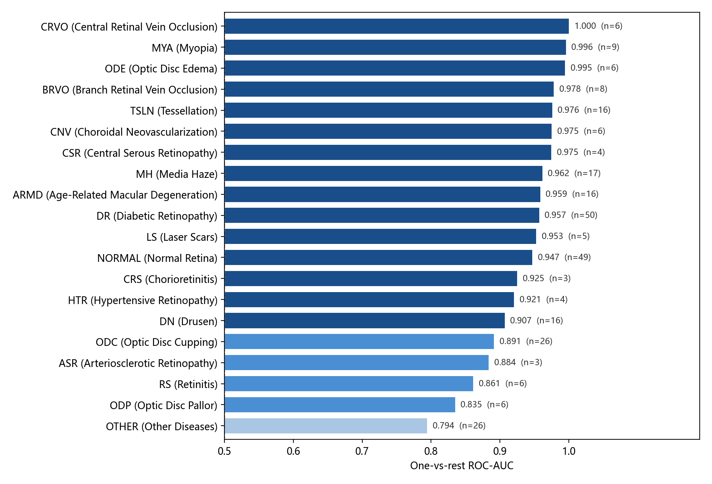
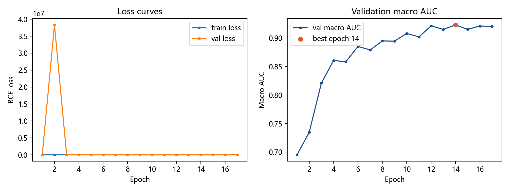
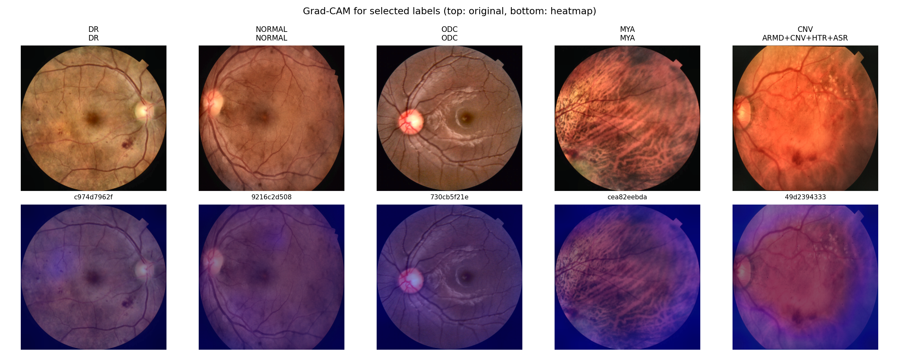

# 基于 EfficientNet-B0 的眼底多标签疾病识别与 Grad-CAM 可解释性分析

在课程发布的 **MuReD 多标签眼底数据集**（20 类标签、2208 张 300×300 彩色眼底图，
训练 1545 / 验证 221 / 测试 442）上，使用 **EfficientNet-B0**（ImageNet 预训练 +
迁移学习）完成眼底疾病的多标签识别，主指标为**宏平均 ROC-AUC**（对 20 个标签
分别计算 one-vs-rest AUC 再取平均），并配套 **Grad-CAM 可解释性分析**与
**Gradio 单图推理演示**。

> 多标签任务说明：一张眼底图可以同时存在多种病变（例如糖网合并黄斑水肿），
> 因此输出是 20 个独立的 sigmoid 概率，而不是 softmax 单选；损失函数相应地
> 使用 BCEWithLogitsLoss，而非交叉熵。

---

## 特性一览

| 维度 | 实现 |
|---|---|
| 可复现 | 固定随机种子、直接使用课程固定划分、超参数全部外置到 `configs/config.yaml` |
| 可解释 | 自实现 Grad-CAM（针对任意单个标签的激活区域），输出多标签对照图 |
| 可演示 | Gradio 界面：上传一张眼底图 → Top 命中标签 + 概率条 + 热力图 |
| 防泄漏 | 使用课程固定划分；增强只挂训练集；验证集不参与反向传播 |
| 不平衡处理 | BCE 正类权重 = 负/正样本比（截断到 20），缓解最大 16 倍的标签频率差异 |

---

## 数据集（MuReD 20 类）

| 划分 | 图像数 | 说明 |
|---|---|---|
| train.csv | 1545 | 20 列 0/1 标签 |
| val.csv | 221 | 20 列 0/1 标签，用于模型选择 |
| test.csv | 442 | 仅 path 列，无标签 |
| images/ | 2208 | 300×300 RGB PNG |

标签顺序：DR, NORMAL, MH, ODC, TSLN, ARMD, DN, MYA, BRVO, ODP, CRVO, CNV, RS, ODE, LS, CSR, HTR, ASR, CRS, OTHER。

正例频率从 DR/NORMAL 的约 22% 到 CRS/ASR 的约 1.4–1.5% 不等，极不平衡；约 22.7% 的训练图像同时具有 2 个以上标签。

---

## 目录结构

```
.
├── configs/config.yaml          全部超参数、路径与随机种子
├── data/                        （本仓库不含数据，请按下方说明放置）
├── src/
│   ├── utils.py                 标签定义、随机种子、多标签指标
│   ├── dataset.py               裁剪黑边 + CLAHE + 数据增强
│   ├── model.py                 EfficientNet-B0 骨干与多标签分类头
│   ├── train.py                 训练、验证、早停与权重保存
│   ├── evaluate.py              指标、逐标签 AUC/F1 表与图表
│   ├── gradcam.py               针对指定标签的 Grad-CAM
│   └── predict.py               生成提交文件 test.csv
├── app/app.py                   Gradio 演示界面
├── outputs/                     权重、日志、图表
├── figures/                     报告与 README 使用的图表
├── requirements.txt
└── README.md
```

---

## 环境安装

```bash
python -m venv venv

# Windows
venv\Scripts\activate
# macOS / Linux
source venv/bin/activate

pip install -r requirements.txt
```

> `torch` 的 CUDA 版本需要与本机显卡驱动匹配，请到
> [pytorch.org](https://pytorch.org) 按系统选择安装命令。本项目在
> **RTX 5060 Laptop（Blackwell, sm_120）+ torch 2.11.0+cu128** 上验证运行；
> 50 系显卡必须使用 CUDA 12.8 及以上的 torch，否则会报
> `no kernel image is available`。

---

## 数据准备

从课程渠道下载 `student_dataset.zip` 并解压，然后在
`configs/config.yaml` 中把以下四个路径改成你的实际位置：

```yaml
data:
  image_dir: <解压目录>/student_dataset/images
  train_csv: <解压目录>/student_dataset/train.csv
  val_csv:   <解压目录>/student_dataset/val.csv
  test_csv:  <解压目录>/student_dataset/test.csv
  sample_submission: <解压目录>/student_dataset/sample_submission.csv
```

> 划分已由课程固定，本仓库不包含任何重新划分的逻辑，`train/val/test`
> 三个 CSV 原样使用。

---

## 快速开始

```bash
# 1. 训练（按验证宏平均 AUC 选权重、早停）
python src/train.py

# 2. 评估（验证集；test.csv 无标签，无法本地评估）
python src/evaluate.py

# 3. 生成提交文件（课程要求命名为 test.csv）
python src/predict.py                 # 输出 outputs/test.csv
python src/predict.py --out ../test.csv

# 可选：Grad-CAM 热力图
python src/gradcam.py --labels DR,NORMAL,ODC,MYA,CNV

# 可选：启动演示界面
python app/app.py
```

---

## 关键配置

全部集中在 `configs/config.yaml`：

| 配置项 | 含义 |
|---|---|
| `seed` | 随机种子，固定后可复现 |
| `data.image_size` | 输入分辨率（默认 300，与数据集一致） |
| `data.clahe` | 是否做 CLAHE 局部对比增强 |
| `train.batch_size` | 批大小，显存不足时调小 |
| `train.lr` | 学习率（默认 1e-4） |
| `train.amp` | 混合精度，加速并降低显存 |
| `train.early_stop_patience` | 验证宏平均 AUC 连续多少轮不升则停止 |
| `train.pos_weight` | 是否使用 BCE 正类权重 |
| `train.pos_weight_cap` | 正类权重上限（默认 20） |
| `train.num_workers` | Windows 上若报错改成 0 |

---

## 输出物

| 路径 | 内容 |
|---|---|
| `outputs/ckpt/best.pth` | 验证宏平均 AUC 最高的权重 |
| `outputs/logs/train_log.csv` | 每轮 loss 与指标 |
| `outputs/logs/metrics_val.json` | 验证集整体指标 |
| `outputs/logs/per_label_val.csv` | 逐标签精确率／召回率／F1／AUC |
| `outputs/figures/label_auc_val.png` | 逐标签 AUC 条形图 |
| `outputs/figures/training_curve.png` | 训练／验证曲线 |
| `outputs/figures/gradcam_labels.png` | 指定标签的 Grad-CAM |
| `outputs/test.csv` | 提交文件（按 sample_submission 格式，20 列概率） |

---

## 实验结果

在 221 张验证集上的实测结果（EfficientNet-B0，ImageNet 预训练，课程固定划分，单一模型无集成）：

| 指标 | 数值 |
|---|---|
| **宏平均 AUC（主指标）** | **0.9268** |
| 微平均 AUC | 0.9494 |
| 微平均 F1（阈值 0.5） | 54.64 % |
| 宏平均 F1（阈值 0.5） | 50.94 % |
| Hamming 正确率 | 91.70 % |

最佳轮次为第 11 轮，第 16 轮早停；单轮约 80 秒，峰值显存 1.33 GiB，总训练 21 分 13 秒。

逐标签 AUC：最高的为 CRVO 1.000、MYA 0.996、ODE 0.995、TSLN 0.976、CSR 0.976；最低的为 OTHER 0.789、ODP 0.805。稀有标签（正例 3–6 张）普遍呈现「AUC 高、F1 低」的形态——排序正确，但 0.5 阈值下的输出偏保守，这类问题更适合用逐标签阈值搜索解决。

与公开结果对照（口径不尽一致，仅作量级参照）：MuReD 原论文 C-Tran 基准 AUC 0.962 / F1 0.573；MUREDNet AUC 0.932 / F1 0.428；原论文复现的 CNN 基线 F1 仅 0.208–0.315。本实验的单模型 CNN（4.34 M 参数）明显优于后者，接近 MUREDNet 水平。

逐标签 AUC 条形图与训练曲线：





Grad-CAM（按标签解释）：



### 逐标签频率（训练集）

| 标签 | 全称 | 正例数 | 占比 |
|---|---|---|---|
| DR | Diabetic Retinopathy | 346 | 22.4% |
| NORMAL | Normal Retina | 346 | 22.4% |
| MH | Media Haze | 118 | 7.6% |
| ODC | Optic Disc Cupping | 184 | 11.9% |
| TSLN | Tessellation | 109 | 7.1% |
| ARMD | Age-Related Macular Degeneration | 110 | 7.1% |
| DN | Drusen | 114 | 7.4% |
| MYA | Myopia | 62 | 4.0% |
| BRVO | Branch Retinal Vein Occlusion | 55 | 3.6% |
| ODP | Optic Disc Pallor | 44 | 2.8% |
| CRVO | Central Retinal Vein Occlusion | 38 | 2.5% |
| CNV | Choroidal Neovascularization | 42 | 2.7% |
| RS | Retinitis | 40 | 2.6% |
| ODE | Optic Disc Edema | 40 | 2.6% |
| LS | Laser Scars | 32 | 2.1% |
| CSR | Central Serous Retinopathy | 25 | 1.6% |
| HTR | Hypertensive Retinopathy | 24 | 1.6% |
| ASR | Arteriosclerotic Retinopathy | 23 | 1.5% |
| CRS | Chorioretinitis | 21 | 1.4% |
| OTHER | Other Diseases | 183 | 11.8% |

---

## 可复现性说明

1. **随机种子固定**：Python / NumPy / PyTorch / CUDA 及 cuDNN 全部固定（`utils.set_seed`）。
2. **划分固化**：直接使用课程发布的 train / val / test 三个 CSV，代码中不存在任何重新划分逻辑。
3. **超参数外置**：全部写在 `configs/config.yaml`，源码中没有硬编码。
4. **验证集隔离**：增强只挂在训练集管道（`FundusMultiLabelDataset(train=True)`）；
   权重选择与早停只读取验证指标，验证集不参与反向传播。
5. **日志留痕**：每轮 loss 与指标写入 CSV / JSON，训练曲线可随时复现核对。

---

## 常见问题

**Q：报错找不到图像。**
A：检查 `configs/config.yaml` 里的 `image_dir` 是否指向 `student_dataset/student_dataset/images`。

**Q：Windows 上 DataLoader 报错。**
A：把 `train.num_workers` 改成 `0`。

**Q：显存不足（OOM）。**
A：把 `batch_size` 降到 8；确认 `amp: true` 已开启；也可把 `image_size` 降到 224。

**Q：在 RTX 50 系显卡上报 `no kernel image is available`。**
A：50 系是 Blackwell 架构（sm_120），需要 **CUDA 12.8 及以上**对应的 torch 版本。

**Q：为什么输出的是概率而不是 0/1？**
A：数据集 README 允许填「预测标签或预测概率」。填概率可以让评测端在计算
AUC 时自行选择阈值，信息量更大；仓库同时会输出一份 0/1 阈值版本
（`outputs/logs/test_binary.csv`）供参考。

---

## 参考资料

- MuReD: Multi-Label Retinal Diseases（Khalifa University，Mendeley Data）
- EfficientNet, Tan & Le, ICML 2019
- Grad-CAM, Selvaraju et al., ICCV 2017

---

## 免责声明

本项目为课程实验与学习用途，模型输出**不构成任何医学诊断依据**，不可用于临床决策。

---

## 许可证

如需开源，建议添加 MIT 许可证。仓库当前未附带 LICENSE 文件。
