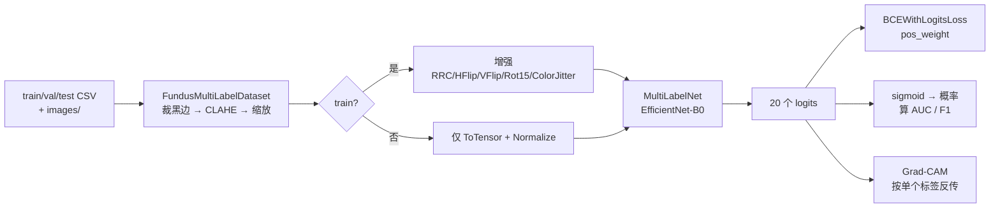

# 架构说明

基于 EfficientNet-B0 的眼底多标签疾病识别与 Grad-CAM 可解释性分析。

## 1. 一句话定位

在 MuReD 多标签眼底数据集（20 类、2208 张 300×300）上做多标签疾病识别，
主指标是**宏平均 ROC-AUC**，并配套 Grad-CAM 可解释性与 Gradio 单图演示。

**关键区别**：多标签 ≠ 多分类。一张眼底图可以同时有糖网 + 黄斑水肿，
所以输出是 **20 个独立 sigmoid 概率**，不是 softmax 单选。

## 2. 数据流

## 3. 模块分层

| 层 | 文件 | 职责 |
|---|---|---|
| **配置** | `configs/config.yaml` | 全部超参、路径、种子（源码无硬编码） |
| **数据** | `src/dataset.py` | 裁黑边、CLAHE、增强、返回 (tensor, y, path) |
| **模型** | `src/model.py` | EfficientNet-B0 骨干 + 多标签头 |
| **训练** | `src/train.py` | 训练/验证、按 val 宏 AUC 选权重、早停 |
| **评估** | `src/evaluate.py` | 整体指标 + 逐标签表 + 图表 |
| **可解释** | `src/gradcam.py` | 针对单个标签的 Grad-CAM |
| **推理** | `src/predict.py` | 生成提交文件（概率 + 阈值版） |
| **演示** | `app/app.py` | Gradio：上传图 → Top 标签 + 概率条 + 热力 |
| **工具** | `src/utils.py` | 标签定义、set_seed、pos_weight、多标签指标 |

## 4. 关键设计决策

| 决策 | 理由 |
|---|---|
| **20 个独立 sigmoid，不用 softmax** | 多标签任务中"糖网"和"黄斑水肿"可以共存，softmax 会强制互斥 |
| **`BCEWithLogitsLoss`** | sigmoid 与交叉熵的合并实现，数值比"先 sigmoid 再 BCE"更稳 |
| **`pos_weight = 负/正`，并 cap 到 20** | 最稀有标签（CRS 仅 21 张）原始权重会超 70，不设上限会让梯度被个别类主导 |
| **CLAHE 只作用在 LAB 的 L 通道** | 只增强亮度对比，不动色度——眼底病变的颜色信息（出血、渗出）必须保留 |
| **训练用 `RandomResizedCrop(scale=0.8~1.0)`** | 让模型**不能依赖"病灶固定在画面某处"这一捷径** |
| **水平 + 垂直翻转都开** | 眼底图没有严格上下方向，两个方向翻转都是合理的解剖变化 |
| **`amp_dtype: bf16`** | bf16 动态范围大，BN 权重极端时不会溢出；fp16 会 |
| **TTA = 水平翻转取平均** | 验证集宏 AUC +0.008，代价极小 |
| **直接使用课程固定划分** | 代码中不存在任何重新划分逻辑，避免无意中造成泄漏 |

## 5. 可复现性设计

五个环节都已固定（见 `utils.set_seed`）：

| 环节 | 做法 |
|---|---|
| 随机源 | `random` / `numpy` / `torch` / `torch.cuda` / `PYTHONHASHSEED` 全部固定 |
| cuDNN | `deterministic=True`、`benchmark=False` |
| 数据划分 | 课程发布的 CSV 原样使用，不重新切分 |
| 超参数 | 全部外置到 `config.yaml` |
| 验证集隔离 | 增强只挂训练集管道；权重选择与早停只读指标，不参与反传 |

## 6. 数据边界

| 项 | 说明 |
|---|---|
| 数据来源 | 课程发布的 `student_dataset`（MuReD 多标签眼底数据集） |
| 仓库内容 | 代码 + 配置 + 图表，**不含数据** |
| 测试集 | `test.csv` **只有 path 列、没有标签** → 只能提交预测，不能本地评估 |
| 用途 | 课程实验与学习，**不构成医学诊断依据**，不可用于临床决策 |
