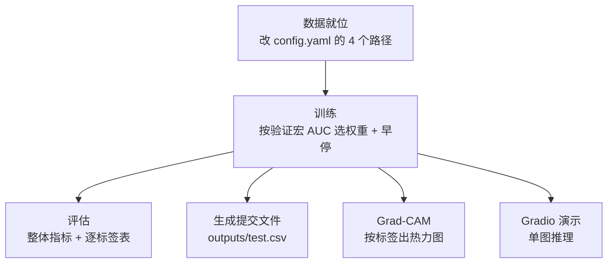
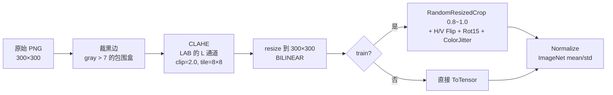
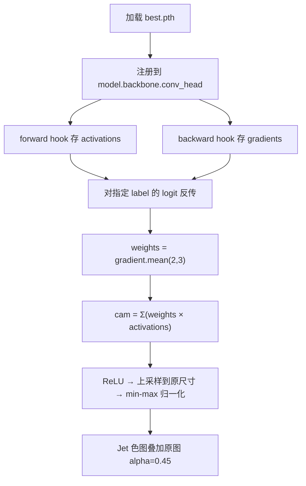

# 执行流程

从一张眼底图到"Top 命中标签 + 热力图"的完整链路。

## 1. 总流程



## 2. 训练流程（`src/train.py`）

| 阶段 | 做什么 | 关键点 |
|---|---|---|
| 1 | `set_seed(42)` | 5 个随机源 + cuDNN 确定性 |
| 2 | 建 DataLoader | train 用增强管道，val 只做张量化 |
| 3 | 每轮：前向 → BCE → 反向 → 更新 | `amp=true` + `bf16`，`pos_weight` 参与损失 |
| 4 | 每轮结束算验证集宏平均 AUC | **这是选权重的唯一依据** |
| 5 | 验证 AUC 创新高 → 存 `best.pth` | 不是按 loss，是按 AUC |
| 6 | 连续 `patience=5` 轮不升 → 早停 | |

**判据**：本机实测最佳轮次第 11 轮，第 16 轮早停，单轮约 80 秒，峰值显存 1.33 GiB。

## 3. 数据预处理链路



**为什么先裁黑边**：眼底图四周是大片黑色，直接缩放会让有效视场占比变小，
白白浪费分辨率。裁到圆形视场的外接矩形后再缩放，病灶的像素密度更高。

**为什么 CLAHE 只动 L 通道**：出血、渗出、微血管瘤都是靠**颜色**区分的，
CLAHE 作用在 LAB 的 L（亮度）通道，只提升局部对比度，不改变色度。

## 4. 评估流程（`src/evaluate.py`）

```
加载 best.pth
  └─ 在 val 上推理 → 20 维概率
       ├─ 每标签 one-vs-rest AUC（全 0 / 全 1 的标签记 NaN 并跳过）
       ├─ 宏平均 AUC = nanmean(per_label_auc)   ← 主指标
       ├─ 微平均 AUC / 微平均 F1 / 宏平均 F1 / Hamming 正确率（阈值 0.5）
       ├─ per_label_val.csv（正例数、P、R、F1、AUC）
       └─ 图表：逐标签 AUC 条形图、训练曲线
```

**为什么"全 0 标签记 NaN 而不是 0"**：某个标签在验证集里一个正例都没有时，
AUC 在数学上无定义。记 0 会把它当成"表现最差"，拉低宏平均，属于**错误归因**。

## 5. 推理与提交（`src/predict.py`）

```
读 test.csv（只有 path）
  └─ 逐图推理 → 20 维概率
       ├─ 若开启 TTA：原图与水平翻转图概率取平均（+0.008 宏 AUC）
       ├─ outputs/test.csv          概率版（推荐，评测端可自选阈值）
       └─ outputs/logs/test_binary.csv  0/1 阈值版（参考）
```

**为什么提交概率而不是 0/1**：数据集 README 允许"预测标签或预测概率"。
给概率，评测端算 AUC 时能自己定阈值，信息量更大；给 0/1 就把阈值选择权交出去了。

## 6. Grad-CAM 流程



**多标签版的唯一改动**：反传目标从"预测类别的分数"改成"**某一个标签的 logit**"。
因为多标签下没有"预测类别"这个概念，必须手动指定要解释哪个标签。

产物：`outputs/figures/gradcam_labels.png`（上排原图、下排热力图，按标签分列）。

## 7. Gradio 演示（`app/app.py`）

```
上传一张眼底图
  └─ 同一套 preprocess（裁边 → CLAHE → resize）
       └─ 推理 + sigmoid
            ├─ 按概率排序取 Top-N 标签
            ├─ 概率条
            └─ 选定标签的 Grad-CAM 热力图
```

## 8. 三条口径（不能混）

| 说法 | 含义 | 容易混淆的地方 |
|---|---|---|
| **宏平均 AUC 0.9268** | 20 个标签的 one-vs-rest AUC 取平均 | 不等于"准确率"，也不等于微平均 |
| **微平均 F1 54.64%** | 把所有标签的 tp/fp/fn 汇总后算 | 与 AUC 不同量纲，**不能说"模型准确率 54%"** |
| **Hamming 91.70%** | 逐元素比较 0/1 的一致率 | 受负类主导（负类本来就多），会显得"很好" |

在 20 类里正例只占少数的场景下，Hamming 91.7% 与 F1 54.6% 可以同时成立——
**引用指标时必须带上名字，不能只说"准确率"**。
